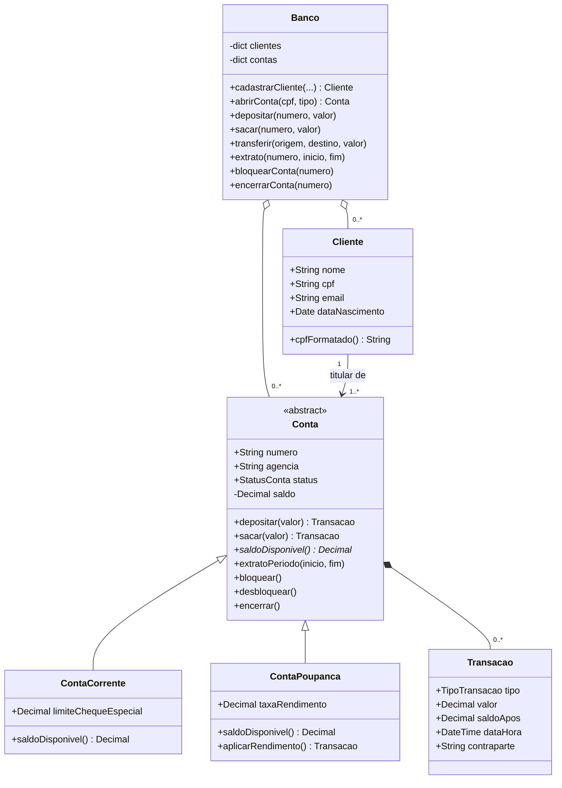

# E3 — Modelo Orientado a Objetos do MiniBank

## 1. Classes centrais (6 classes + 2 enumerações)

| Classe | Responsabilidade |
|---|---|
| **Banco** | Fachada do domínio: guarda clientes e contas e coordena as operações (inclusive a transferência atômica) |
| **Cliente** | Pessoa titular das contas; valida CPF, nome e e-mail |
| **Conta** *(abstrata)* | Regras comuns de toda conta: saldo, status, depósito, saque, extrato, bloqueio e encerramento |
| **ContaCorrente** | Conta que admite cheque especial (limite adicional ao saldo) |
| **ContaPoupanca** | Conta sem cheque especial, com taxa de rendimento |
| **Transacao** | Registro imutável de cada movimentação (linha do extrato) |

Enumerações: `StatusConta` (ATIVA, BLOQUEADA, ENCERRADA) e `TipoTransacao` (DEPÓSITO, SAQUE, TRANSFERÊNCIA ENVIADA, TRANSFERÊNCIA RECEBIDA, RENDIMENTO).

## 2. Atributos e operações

| Classe | Atributos | Operações |
|---|---|---|
| Banco | clientes, contas | cadastrarCliente, buscarCliente, abrirConta, buscarConta, depositar, sacar, transferir, extrato, bloquearConta, desbloquearConta, encerrarConta |
| Cliente | nome, cpf, email, dataNascimento | cpfFormatado |
| Conta | numero, agencia, titular, status, saldo, transações | depositar, sacar, saldoDisponivel *(abstrata)*, extratoPeriodo, bloquear, desbloquear, encerrar |
| ContaCorrente | limiteChequeEspecial | saldoDisponivel = saldo + limite |
| ContaPoupanca | taxaRendimento | saldoDisponivel = saldo; aplicarRendimento |
| Transacao | tipo, valor, saldoApos, dataHora, contraparte | — (objeto de dados imutável) |

## 3. Relacionamentos

| Relacionamento | Tipo | Multiplicidade | Justificativa |
|---|---|---|---|
| Banco → Cliente | Agregação | 1 para 0..* | O banco reúne clientes, mas o cliente é uma entidade própria |
| Banco → Conta | Agregação | 1 para 0..* | O banco mantém as contas abertas |
| Cliente → Conta | Associação | 1 para 1..* | Cada conta tem um titular; um cliente pode ter várias contas (RF03) |
| ContaCorrente / ContaPoupanca → Conta | Herança | — | Compartilham as regras e diferem em `saldoDisponivel` |
| Conta → Transacao | Composição | 1 para 0..* | O extrato só existe como parte da conta; sem a conta, as transações perdem sentido |

## 4. Diagrama de classes




## 5. Manutenção prevista

| Mudança futura provável | Tipo de manutenção | Onde impacta |
|---|---|---|
| Corrigir arredondamento ou regra de saque se um teste ou o uso real revelar erro | **Corretiva** | `Conta.validar_debito`, `para_decimal` |
| Trocar o armazenamento em memória por PostgreSQL | **Adaptativa** | Camada de persistência (novo repositório); `Banco` deixa de usar dicionários |
| Adicionar PIX e exportação do extrato em PDF | **Perfectiva/evolutiva** | Novo tipo de `Transacao`, novos serviços |
| Extrair a validação de `Conta` para uma política própria antes de crescer o número de tipos de conta | **Preventiva** | `Conta` e subclasses |

## 6. Primeiro incremento funcional

O incremento implementa o núcleo do domínio e uma interface de linha de comando, coerente com os requisitos e com o diagrama acima.

| Requisito | Situação |
|---|---|
| RF01 Cadastro de cliente | Implementado (`Banco.cadastrar_cliente`) |
| RF03 Abertura de conta corrente/poupança | Implementado (`Banco.abrir_conta`) |
| RF04 Depósito | Implementado |
| RF05 Saque com saldo suficiente | Implementado (inclui limite do cheque especial) |
| RF06 Transferência atômica | Implementado |
| RF07 Saldo e extrato por período | Implementado |
| RF08 Bloquear, desbloquear e encerrar | Implementado |
| RNF02 Integridade (Decimal, atomicidade) | Atendido |
| RNF06 Testes automatizados | 20 testes unitários |
| RF02 Autenticação, RNF01 Segurança, RNF04 Auditoria | Pendentes (próximo incremento) |

### Como executar

Requisito: Python 3.9 ou superior (nenhuma biblioteca externa).

```bash
# Testes automatizados (a partir da raiz do repositório)
python -m unittest discover -s tests -v

# Demonstração automática (a partir da pasta src/)
cd src
python -m banco --demo

# Menu interativo
python -m banco
```

CPFs válidos para teste: `529.982.247-25` e `111.444.777-35`.
