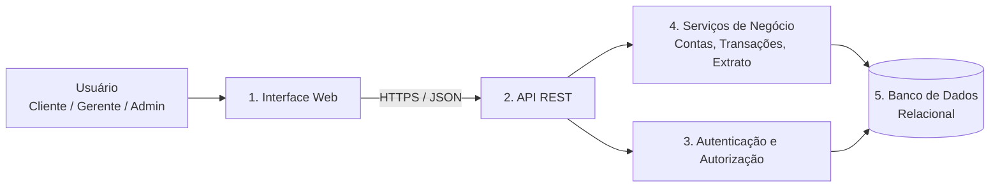

# E2 — Arquitetura de Alto Nível

Arquitetura em camadas com 5 blocos:

| # | Bloco | Responsabilidade |
|---|---|---|
| 1 | **Interface Web** | Telas para login, saldo, extrato, depósito, saque, transferência e administração de contas. Apresenta dados e valida entradas básicas. |
| 2 | **API REST** | Ponto único de entrada do back-end; recebe requisições, valida formato, aplica autenticação e delega aos serviços. |
| 3 | **Autenticação e Autorização** | Login, hash de senhas, emissão/validação de token e controle de perfis (cliente, gerente, administrador). |
| 4 | **Serviços de Negócio** | Regras do domínio: saldo suficiente, conta ativa, atomicidade das transferências, geração de extrato e auditoria. |
| 5 | **Banco de Dados** | Persistência de clientes, contas, transações e logs de auditoria com transações ACID. |

> Tecnologias sugeridas (decisão de projeto, não requisito): front-end web (HTML/JS ou React), API em Python (FastAPI) e PostgreSQL.

## Interfaces principais (API REST)
| Método | Endpoint | Descrição | Requisito |
|---|---|---|---|
| POST | `/clientes` | Cadastrar cliente | RF01 |
| POST | `/auth/login` | Autenticar e obter token | RF02 |
| POST | `/contas` | Abrir conta | RF03 |
| POST | `/contas/{id}/depositos` | Depositar | RF04 |
| POST | `/contas/{id}/saques` | Sacar | RF05 |
| POST | `/transferencias` | Transferir entre contas | RF06 |
| GET | `/contas/{id}/saldo` | Consultar saldo | RF07 |
| GET | `/contas/{id}/extrato?inicio=&fim=` | Consultar extrato | RF07 |
| PATCH | `/contas/{id}/status` | Bloquear/desbloquear/encerrar | RF08 |

## Principais dados manipulados
| Entidade | Atributos principais |
|---|---|
| Cliente | id, nome, cpf, email, dataNascimento |
| Usuario | id, login, senhaHash, perfil |
| Conta | id, numero, agencia, tipo, saldo, status, clienteId |
| Transacao | id, contaOrigemId, contaDestinoId, tipo, valor, dataHora, saldoApos |
| Auditoria | id, usuarioId, acao, dataHora, detalhes |
