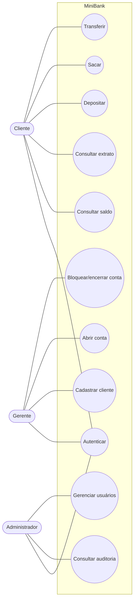
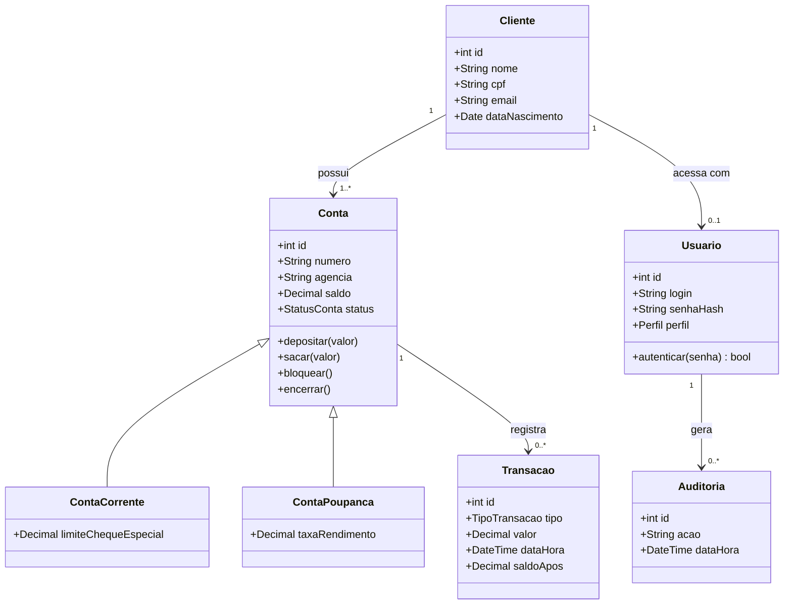
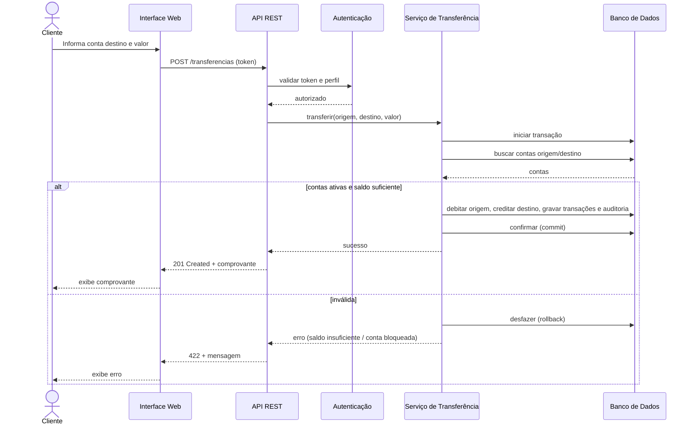
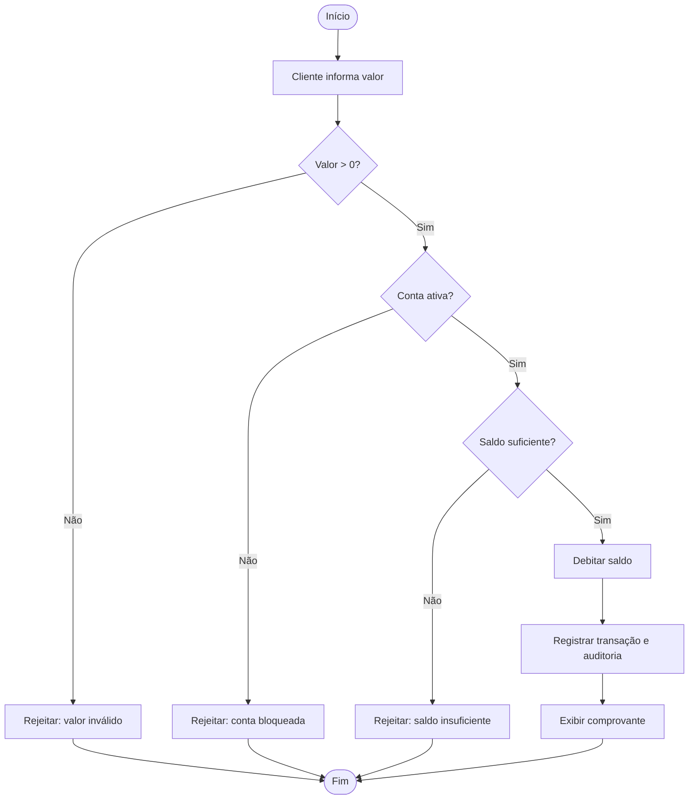

# E2 — Diagramas UML

## 1. Diagrama de Casos de Uso (atores e funcionalidades)

## 2. Diagrama de Classes (domínio)

## 3. Diagrama de Sequência — Transferência entre contas (RF06)

## 4. Diagrama de Atividades — Saque

